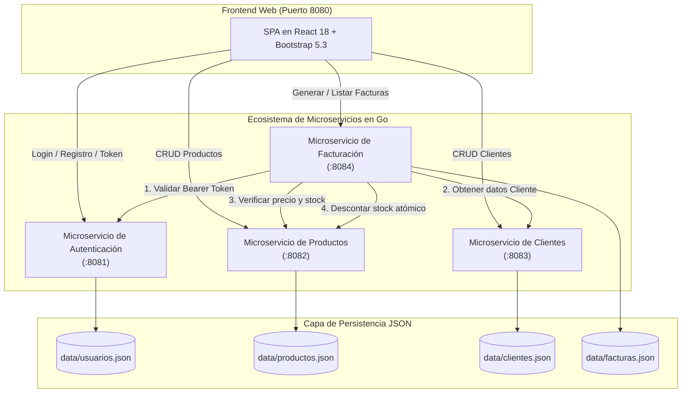
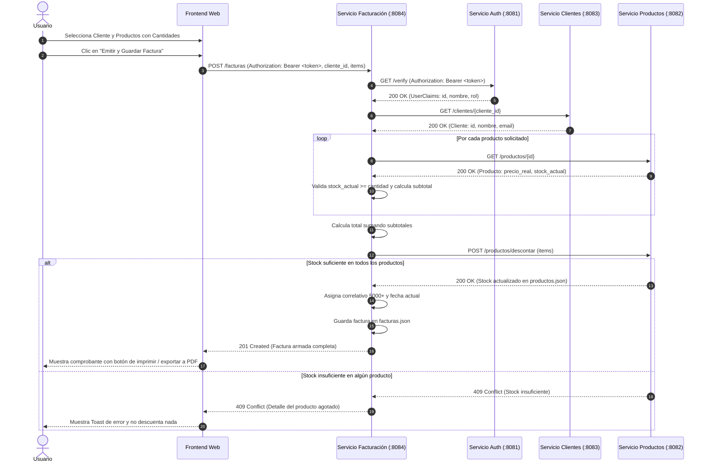

# Arquitectura del Sistema de Facturación Digital

Este documento describe la arquitectura modular del sistema de facturación basado en microservicios independientes desarrollados en **Go** y un cliente web en **JavaScript**, con persistencia en archivos **JSON**.

---

## 1. Diagrama de Arquitectura del Sistema



---

## 2. Descripción de Componentes

| Componente | Puerto | Archivo de Persistencia | Responsabilidad Principal |
| :--- | :---: | :--- | :--- |
| **Auth Service** | `8081` | `data/usuarios.json` | Registro de usuarios, hashing de contraseñas con `bcrypt`, generación y validación de tokens HMAC-SHA256. |
| **Productos Service** | `8082` | `data/productos.json` | CRUD de productos, validación de precios (>0) y stock (>=0), y descuento atómico de existencias. |
| **Clientes Service** | `8083` | `data/clientes.json` | CRUD de clientes, validación de datos requeridos y control de duplicidad en identificación (`cc`) y correo (`email`). |
| **Facturación Service** | `8084` | `data/facturas.json` | Orquestador de facturación: consume Auth, Clientes y Productos, calcula subtotales y total en backend, reserva existencias y persiste facturas. |
| **Frontend Web** | `8080` | N/A | Interfaz de usuario responsiva, panel de control, gestión de catálogos, emisión y visualización / impresión a PDF. |

---

## 3. Catálogo de Endpoints REST

### 3.1. Microservicio de Autenticación (`:8081`)

| Método | Endpoint | Descripción | Encabezados Requeridos |
| :--- | :--- | :--- | :--- |
| `POST` | `/register` | Registra un nuevo usuario con contraseña cifrada (bcrypt). | `Content-Type: application/json` |
| `POST` | `/login` | Valida credenciales y genera un token Bearer firmado. | `Content-Type: application/json` |
| `GET` | `/verify` | Valida el token del usuario y retorna claims de identidad. | `Authorization: Bearer <token>` |
| `GET` | `/usuarios` | Lista todos los usuarios registrados (sin contraseñas). | Ninguno |
| `GET` | `/usuarios/{id}` | Retorna el detalle de un usuario por su identificador. | Ninguno |

### 3.2. Microservicio de Productos (`:8082`)

| Método | Endpoint | Descripción | Payload / Parámetros |
| :--- | :--- | :--- | :--- |
| `GET` | `/productos` | Lista todos los productos disponibles. | Ninguno |
| `GET` | `/productos/{id}` | Obtiene los datos de un producto específico. | ID en URL |
| `POST` | `/productos` | Registra un nuevo producto (nombre, precio > 0, stock >= 0). | `{ "nombre": "...", "precio": 12000.0, "stock": 50 }` |
| `PUT` | `/productos/{id}` | Actualiza información de un producto existente. | Campos modificados |
| `DELETE`| `/productos/{id}` | Elimina un producto del catálogo. | ID en URL |
| `POST` | `/productos/descontar` | Aplica un descuento atómico a una lista de productos. | `{ "items": [{ "id": 101, "cantidad": 2 }] }` |

### 3.3. Microservicio de Clientes (`:8083`)

| Método | Endpoint | Descripción | Payload / Parámetros |
| :--- | :--- | :--- | :--- |
| `GET` | `/clientes` | Obtiene la lista completa de clientes. | Ninguno |
| `GET` | `/clientes/{id}` | Consulta un cliente por ID. | ID en URL |
| `POST` | `/clientes` | Registra un nuevo cliente (nombre, cc, email, dirección). | `{ "nombre": "...", "cc": "...", "email": "...", "direccion": "..." }` |
| `PUT` | `/clientes/{id}` | Actualiza datos de un cliente. | Campos modificados |
| `DELETE`| `/clientes/{id}` | Elimina un cliente registrado. | ID en URL |

### 3.4. Microservicio de Facturación (`:8084`)

| Método | Endpoint | Descripción | Seguridad / Encabezados |
| :--- | :--- | :--- | :--- |
| `POST` | `/facturas` | Genera una nueva factura orquestando los 3 servicios. | `Authorization: Bearer <token>` |
| `GET` | `/facturas` | Lista todas las facturas históricas generadas. | Ninguno |
| `GET` | `/facturas/{id}` | Obtiene el detalle de una factura por su ID. | ID en URL |

---

## 4. Flujo Detallado de Emisión de Facturas



---

## 5. Ejemplo de Factura Generada (Estándar del PDF)

Estructura persistida en `data/facturas.json`:

```json
[
  {
    "factura_id": 5001,
    "cliente": {
      "id": 201,
      "nombre": "Carlos Pérez",
      "email": "carlos@example.com"
    },
    "usuario": {
      "id": 1,
      "nombre": "Ricardo Gómez",
      "rol": "admin"
    },
    "productos": [
      {
        "id": 101,
        "nombre": "Laptop Lenovo ThinkPad",
        "cantidad": 1,
        "precio_unitario": 3500000.00,
        "subtotal": 3500000.00
      },
      {
        "id": 102,
        "nombre": "Mouse inalámbrico Logitech",
        "cantidad": 2,
        "precio_unitario": 12000.00,
        "subtotal": 24000.00
      }
    ],
    "total": 3524000.00,
    "fecha": "2026-10-18"
  }
]
```

---

## 6. Mecanismos de Seguridad y Concurrencia

1. **Persistencia Concurrente Segura:**
   Todos los repositorios implementan `sync.RWMutex` para garantizar lecturas simultáneas seguras y escrituras exclusivas atómicas, evitando corrupción de archivos JSON.
2. **Cifrado de Contraseñas:**
   Uso de `golang.org/x/crypto/bcrypt` con costo estándar. Las contraseñas nunca se guardan en texto claro ni se devuelven en las respuestas de la API.
3. **Cálculo de Importes en el Servidor:**
   El frontend únicamente envía IDs de producto y cantidades solicitadas; el backend consulta los precios oficiales y calcula subtotales y total sin confiar en la entrada del cliente.
4. **Descuento Atómico de Existencias:**
   El endpoint `/productos/descontar` realiza una verificación preliminar de la totalidad del pedido antes de descontar inventario, previniendo estados inconsistentes o stock negativo.
